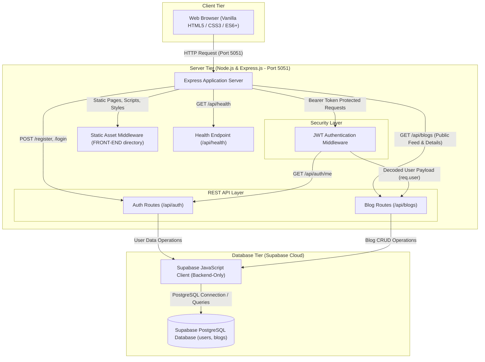

<div align="center">

# ✒️ InkSpace

**A little space for big ideas**

      

</div>

---

## 📖 Overview

**InkSpace** is a modern, unified full-stack publishing platform designed for writers, students, and creators to share thoughts, college experiences, technical insights, and personal stories. Crafted with focus on simplicity, responsiveness, and clean typography, InkSpace provides an intuitive writing environment that feels warm, distraction-free, and inviting.

Architecturally, the application utilizes a streamlined single-process model where a Node.js and Express server simultaneously powers the high-performance RESTful API and serves the zero-dependency vanilla frontend. This design eliminates the overhead of multi-container setups, dev server proxies, or decoupled microservices during development, enabling the complete full-stack application to boot effortlessly in seconds on a single port.

InkSpace pairs cloud-native data persistence via **Supabase (PostgreSQL)** with an enterprise-grade security layer. User authentication is powered by salted `bcryptjs` password hashing and cryptographically signed JSON Web Tokens (JWT). The client interface features an adaptive light/dark theme system, asynchronous shimmer skeleton states, subtle parallax scroll experiences with reduced-motion support, live client-side word counting, and cryptographic password generation.

---

## ✨ Features

### ✍️ Writing & Publishing
* **Story Authoring & Editing**: Intuitive article creator with live form validation for titles (max 120 chars), excerpts (max 250 chars), and rich body content.
* **Drafts & Instant Publishing**: Seamlessly toggle stories between `draft` and `published` states directly from the editor or the dashboard.
* **Dynamic Word Counter**: Real-time client-side word count tracking as you write your story.
* **Cover Image Integration**: Support for custom cover image URLs (HTTP/HTTPS validated) with automatic graceful fallbacks to typographic placeholders.
* **Full Article Detail View**: Dedicated reading view (`blog.html?id=...`) with sanitized content rendering, author attribution, and publication timestamps.
* **Safe Story Deletion**: Author-only deletion capability with confirmation safeguards.

### 🔐 Authentication & Security
* **User Registration & Login**: Validated registration flow with normalized email handling and minimum password complexity constraints.
* **Stateless JWT Sessions**: JSON Web Tokens with 7-day expiration for secure, decoupled API authorization.
* **Salted Password Hashing**: Passwords hashed with `bcryptjs` utilizing 12 salt rounds before database persistence.
* **Cryptographic Password Generator**: In-browser secure random password generator using `crypto.getRandomValues()` with one-click regeneration and clipboard copying.
* **Route Guards & Protection**: Client-side route guarding for private pages (`dashboard.html`, `create-blog.html`) and server-side middleware protection on sensitive endpoints.
* **Password Visibility Toggle**: Interactive show/hide password buttons with full ARIA accessibility attributes.

### 📊 Dashboard & Story Management
* **Real-time Writing Statistics**: Live summary cards displaying total stories written, active published stories, and saved drafts.
* **Status-based Filtering**: Quickly filter personal stories by status (`All`, `published`, `draft`).
* **Direct Story Actions**: Inline controls on each story card to Edit, Toggle Publish Status, or Delete.
* **Personalized Experience**: Dynamic welcome banner greeting the authenticated user by name with generated avatar initials.

### 🔍 Discovery & Feed
* **Universal Search**: Real-time search scanning story titles, introductions, categories, author names, and full story content.
* **Curated Category Filters**: Instant filtering across five preset categories: `College Life`, `Technology`, `Personal`, `Stories`, and `Lifestyle`.
* **Payload-Optimized Feed**: Public listing endpoint omits full story bodies for low network overhead, while individual detail endpoints deliver complete articles.
* **Empty States & Error Handling**: Contextual feedback screens for empty search results, missing stories, or network disconnects.

### 🎨 Design & User Experience
* **Responsive Layout**: Fluid UI tailored for mobile phones, tablets, laptops, and ultra-wide desktop monitors.
* **Dark & Light Mode**: Built-in dual-theme palette persisted across visits in `localStorage`.
* **Skeleton Loading Screens**: Polished shimmer placeholders for the navigation header and story cards during asynchronous API fetching.
* **Parallax & Scroll Animations**: Subtle floating orbs and rings with IntersectionObserver entrance reveals, respecting user `prefers-reduced-motion` settings.
* **Accessible Engineering**: Semantic HTML5 tags, high-contrast focus rings (`:focus-visible`), ARIA live regions, and screen-reader accessible forms.

---

## 🛠️ Tech Stack

| Layer | Technology | Purpose |
|---|---|---|
| **Frontend Markup** | HTML5 | Accessible, semantic document structures across all application views |
| **Frontend Styling** | CSS3 & Custom Properties | Theme tokens (light/dark), fluid typography, flexbox/grid layout, shimmer animations |
| **Client Scripting** | Vanilla JavaScript (ES6+) | DOM orchestration, Fetch API communication, client-side routing, state management |
| **Backend Runtime** | Node.js (v18+) | Asynchronous server execution environment |
| **Web Server & REST API** | Express.js 4 | API routing, JSON body parsing, error handling, and static frontend hosting |
| **Cloud Database** | Supabase (PostgreSQL) | Managed relational database storage, indexes, and Row Level Security (RLS) |
| **Authentication** | JSON Web Tokens (`jsonwebtoken`) | Signed stateless token authentication (7-day validity) |
| **Password Security** | `bcryptjs` | Multi-round salted password hashing (work factor: 12) |
| **Environment Configuration** | `dotenv` | Safe injection of system secrets and database credentials |
| **CORS Middleware** | `cors` | Configurable Cross-Origin Resource Sharing security layer |

---

## 🏗️ Architecture

InkSpace is engineered as a unified single-tier process: the Express server handles both static client delivery and RESTful API endpoints. Protected endpoints pass through the JWT verification middleware before interacting with Supabase via the backend client.



---

## 📁 Project Structure

```text
Internship_Project/
├── BACK-END/
│   ├── src/
│   │   ├── middleware/
│   │   │   └── auth.js             # JWT verification and user identity extraction
│   │   ├── models/
│   │   │   ├── Blog.js             # Blog domain entity specification
│   │   │   └── User.js             # User domain entity specification
│   │   ├── routes/
│   │   │   ├── authRoutes.js       # User registration, login, and profile routes
│   │   │   └── blogRoutes.js       # Blog CRUD, search, filter, and feed routes
│   │   ├── dataBlogStore.js        # Supabase data layer for blogs table
│   │   ├── dataStore.js            # Supabase data layer for users table
│   │   └── supabaseClient.js       # Supabase client instantiation and query runner
│   ├── .env                        # Local environment secrets (excluded from git)
│   ├── .env.example                # Template for environment configuration
│   ├── e2e_test.js                 # Automated end-to-end integration test suite
│   ├── package.json                # Project dependencies and script definitions
│   ├── server.js                   # Express application entry point & static server
│   └── supabase-schema.sql         # Database schema, table definitions, and RLS policies
├── FRONT-END/
│   ├── blog.html                   # Individual story reading view
│   ├── create-blog.html            # Story creation and editing workspace
│   ├── dashboard.html              # Authenticated writer dashboard and metrics
│   ├── index.html                  # Public home page and discovery feed
│   ├── login.html                  # User login view
│   ├── register.html               # New user registration view
│   ├── script.js                   # Client-side application controller and API client
│   └── style.css                   # Custom styles, theme tokens, and animations
├── .gitignore                      # Git exclusion rules for node_modules, .env, and logs
└── README.md                       # Complete project documentation
```

---

## 📋 Prerequisites

Before running InkSpace locally, ensure you have the following installed and configured:

* **Node.js**: Version `18.0.0` or higher ([Download Node.js](https://nodejs.org/))
* **npm**: Version `9.0.0` or higher (bundled with Node.js)
* **Supabase Account**: A free cloud account on [Supabase](https://supabase.com) with an active project

---

## 🚀 Getting Started

Follow these numbered steps to run the complete application on your local machine:

### 1. Clone the Repository
Clone the project repository to your preferred local directory:

```bash
git clone https://github.com/your-username/InkSpace.git
cd InkSpace
```

### 2. Install Dependencies
Navigate to the `BACK-END` folder and install all required packages:

```bash
cd BACK-END
npm install
```

### 3. Set Up Supabase Database
1. Log in to your [Supabase Dashboard](https://supabase.com/dashboard) and create a new project.
2. In the left navigation, open the **SQL Editor**.
3. Click **New query**, paste the entire contents of [`BACK-END/supabase-schema.sql`](BACK-END/supabase-schema.sql), and click **Run**.
4. Confirm that the `public.users` and `public.blogs` tables have been created with their associated indexes.

### 4. Configure Environment Variables
Create your local environment configuration file by copying the provided template:

**PowerShell (Windows):**
```powershell
Copy-Item .env.example .env
```

**Bash / macOS / Linux:**
```bash
cp .env.example .env
```

Open `.env` in your editor and fill in your Supabase credentials and a secret key:

```env
PORT=5051
JWT_SECRET=generate_a_long_cryptographically_secure_random_string_here
CLIENT_ORIGIN=http://localhost:5051
SUPABASE_URL=https://your-project-id.supabase.co
SUPABASE_SECRET_KEY=sb_secret_your_backend_only_secret_key
```

> **Note:** Retrieve your `SUPABASE_URL` and `SUPABASE_SECRET_KEY` (or legacy `SUPABASE_SERVICE_ROLE_KEY`) from your Supabase Dashboard under **Project Settings** > **API**. Never expose this key in client-side code.

### 5. Start the Server
Start the Express server in development mode:

```bash
npm run dev
```

Alternatively, to run the standard production script:

```bash
npm start
```

You will see output confirming startup:
```text
InkSpace API listening on http://localhost:5051
Frontend served from http://localhost:5051
```

### 6. Open in Browser
Open your web browser and navigate to:

```text
http://localhost:5051
```

The application is completely self-contained. Both the frontend client and the REST API run together on port `5051`.

---

## 🔐 Environment Variables

The application is configured through environment variables located in `BACK-END/.env`. Below is a reference for every supported setting:

| Variable | Required | Default | Description |
|---|---|---|---|
| `PORT` | No | `5051` | The network port on which the Express server listens for HTTP requests. |
| `JWT_SECRET` | **Yes** | *None* | High-entropy private secret key used to sign and verify JSON Web Tokens. Must be kept confidential and distinct from Supabase keys. |
| `CLIENT_ORIGIN` | No | `http://localhost:5051` | Allowed origin for CORS headers. Set to your production domain when deploying. |
| `SUPABASE_URL` | **Yes** | *None* | The public HTTPS endpoint of your Supabase instance (`https://<project-ref>.supabase.co`). |
| `SUPABASE_SECRET_KEY` | **Yes** | *None* | The backend service key (`sb_secret_...` or legacy `SUPABASE_SERVICE_ROLE_KEY`). Bypasses RLS to manage application data securely on the server. |

---

## 📡 API Reference

All API endpoints are prefixed with `/api`. Protected routes require an `Authorization` header containing a valid Bearer token.

### Endpoint Overview

| Method | Endpoint | Auth | Description |
|---|---|:---:|---|
| `GET` | `/api/health` | None | Verify server status and Supabase connectivity |
| `POST` | `/api/auth/register` | None | Register a new user and receive an authentication token |
| `POST` | `/api/auth/login` | None | Authenticate user credentials and receive an authentication token |
| `GET` | `/api/auth/me` | Bearer Token | Retrieve profile information for the current user |
| `GET` | `/api/blogs` | None | List published stories (supports `?search=` and `?category=`) |
| `GET` | `/api/blogs/:id` | None | Fetch full content and metadata for a specific published story |
| `GET` | `/api/blogs/mine` | Bearer Token | List all stories created by the authenticated user (including drafts) |
| `POST` | `/api/blogs` | Bearer Token | Create a new story in `draft` or `published` status |
| `PUT` | `/api/blogs/:id` | Bearer Token | Update an existing story owned by the authenticated user |
| `DELETE` | `/api/blogs/:id` | Bearer Token | Delete an existing story owned by the authenticated user |

---

### Request & Response Examples

#### 1. Register User
**`POST /api/auth/register`**

*Request Body:*
```json
{
  "name": "Jane Doe",
  "email": "jane@example.com",
  "password": "Password@1234"
}
```

*Response (`201 Created`):*
```json
{
  "success": true,
  "message": "Account created successfully.",
  "token": "eyJhbGciOiJIUzI1NiIsInR5cCI6IkpXVCJ9...",
  "user": {
    "id": "7f09bfcf-8515-4ba5-a859-4d6d67bce1df",
    "name": "Jane Doe",
    "email": "jane@example.com"
  }
}
```

---

#### 2. User Login
**`POST /api/auth/login`**

*Request Body:*
```json
{
  "email": "jane@example.com",
  "password": "Password@1234"
}
```

*Response (`200 OK`):*
```json
{
  "success": true,
  "message": "Login successful.",
  "token": "eyJhbGciOiJIUzI1NiIsInR5cCI6IkpXVCJ9...",
  "user": {
    "id": "7f09bfcf-8515-4ba5-a859-4d6d67bce1df",
    "name": "Jane Doe",
    "email": "jane@example.com"
  }
}
```

---

#### 3. Fetch Published Stories
**`GET /api/blogs?category=Technology&search=javascript`**

*Response (`200 OK`):*
```json
{
  "success": true,
  "count": 1,
  "blogs": [
    {
      "id": "e2279b9a-8a6a-4b95-a81d-85fae446d3b4",
      "title": "Mastering Async/Await in JavaScript",
      "category": "Technology",
      "cover": "https://images.unsplash.com/photo-1579468118864-1b9ea3c0db4a",
      "excerpt": "A deep dive into promises and asynchronous patterns.",
      "status": "published",
      "author": "Jane Doe",
      "authorEmail": "jane@example.com",
      "authorId": "7f09bfcf-8515-4ba5-a859-4d6d67bce1df",
      "createdAt": "2026-11-14T12:00:00.000Z",
      "updatedAt": "2026-11-14T12:00:00.000Z"
    }
  ]
}
```
*(Note: Full story body is withheld from public feed listings for bandwidth efficiency.)*

---

#### 4. Create a Story
**`POST /api/blogs`**  
*Header: `Authorization: Bearer <token>`*

*Request Body:*
```json
{
  "title": "My First Semester Learnings",
  "category": "College Life",
  "cover": "https://images.unsplash.com/photo-1523240795612-9a054b0db644",
  "excerpt": "Reflections on transitioning into campus life.",
  "content": "Stepping onto campus on the very first day felt overwhelming...",
  "status": "published"
}
```

*Response (`201 Created`):*
```json
{
  "success": true,
  "message": "Story saved successfully.",
  "blog": {
    "id": "19b4cfb0-efcb-4c92-bce4-6e216895318f",
    "title": "My First Semester Learnings",
    "category": "College Life",
    "cover": "https://images.unsplash.com/photo-1523240795612-9a054b0db644",
    "excerpt": "Reflections on transitioning into campus life.",
    "content": "Stepping onto campus on the very first day felt overwhelming...",
    "status": "published",
    "author": "Jane Doe",
    "authorEmail": "jane@example.com",
    "authorId": "7f09bfcf-8515-4ba5-a859-4d6d67bce1df",
    "createdAt": "2026-11-14T13:30:00.000Z",
    "updatedAt": "2026-11-14T13:30:00.000Z"
  }
}
```

---

## 🗄️ Database Schema

InkSpace uses a relational PostgreSQL schema hosted on Supabase, initialized via [`BACK-END/supabase-schema.sql`](BACK-END/supabase-schema.sql).

### `public.users` Table
Stores registered user accounts and encrypted authentication credentials.

| Column | Type | Constraints | Description |
|---|---|---|---|
| `id` | `UUID` | `PRIMARY KEY` | Unique identifier generated on registration |
| `name` | `TEXT` | `NOT NULL`, `DEFAULT ''` | Full name of the user (2–80 characters) |
| `email` | `TEXT` | `UNIQUE`, `NOT NULL` | Lowercase email address used for login |
| `password_hash` | `TEXT` | `NOT NULL` | Multi-round salted bcrypt password hash |
| `created_at` | `TIMESTAMPTZ` | `NOT NULL`, `DEFAULT now()` | Account creation timestamp |

---

### `public.blogs` Table
Stores published stories and private drafts with relational author attribution.

| Column | Type | Constraints | Description |
|---|---|---|---|
| `id` | `UUID` | `PRIMARY KEY`, `DEFAULT gen_random_uuid()` | Unique identifier for each story |
| `title` | `TEXT` | `NOT NULL` | Story title (max 120 characters) |
| `category` | `TEXT` | `NOT NULL` | Curated category name |
| `cover` | `TEXT` | `NOT NULL`, `DEFAULT ''` | Optional HTTP/HTTPS cover image URL |
| `excerpt` | `TEXT` | `NOT NULL` | Brief summary or intro (max 250 characters) |
| `content` | `TEXT` | `NOT NULL` | Full story text body |
| `status` | `TEXT` | `NOT NULL`, `DEFAULT 'published'`, `CHECK (status IN ('draft', 'published'))` | Publication lifecycle status |
| `author` | `TEXT` | `NOT NULL` | Display name of the author |
| `author_email` | `TEXT` | `NOT NULL` | Contact email of the author |
| `author_id` | `UUID` | `NOT NULL`, `REFERENCES public.users(id) ON DELETE CASCADE` | Foreign key linking to the author user record |
| `created_at` | `TIMESTAMPTZ` | `NOT NULL`, `DEFAULT now()` | Initial creation timestamp |
| `updated_at` | `TIMESTAMPTZ` | `NOT NULL`, `DEFAULT now()` | Last update timestamp |

### Database Indexes & RLS
* **Indexes**: 
  * `blogs_author_id_idx` on `public.blogs(author_id)` for high-speed dashboard query execution.
  * `blogs_status_idx` on `public.blogs(status)` for optimized public feed filtering.
* **Row Level Security (RLS)**: Enabled on both `users` and `blogs` tables with granular policies for public reads and authenticated author modifications. The Node.js backend connects using the elevated service-role key and validates permissions through application-level JWTs.

---

## 💻 Development & Testing

### Syntax Verification
To validate JavaScript syntax without booting the server, run Node's built-in syntax checker:

```powershell
cd BACK-END
node --check server.js
node --check src\routes\authRoutes.js
node --check src\routes\blogRoutes.js
node --check ..\FRONT-END\script.js
```

### Development Server
Run the application server with automatic restarts using nodemon:

```bash
npm run dev
```

### Automated End-to-End Tests
InkSpace includes a comprehensive, standalone integration test suite in [`BACK-END/e2e_test.js`](BACK-END/e2e_test.js). With your backend running on `http://localhost:5051` and Supabase configured, open another terminal and run:

```bash
cd BACK-END
node e2e_test.js
```

The automated test validates:
1. Health check endpoint status (`GET /api/health`).
2. User registration and token issuance (`POST /api/auth/register`).
3. Credential authentication and token verification (`POST /api/auth/login`).
4. Current profile retrieval (`GET /api/auth/me`).
5. Unauthorized route rejection (`401 Unauthorized` checks).
6. Story publishing, excerpt truncation, and detail retrieval (`POST`, `GET /api/blogs`).
7. Content-based full-text searching (`GET /api/blogs?search=...`).
8. Personal dashboard story listings (`GET /api/blogs/mine`).
9. Updating and toggling story status to draft (`PUT /api/blogs/:id`).
10. Story deletion and cleanup (`DELETE /api/blogs/:id`).
11. Static asset serving for `index.html` and `script.js`.

### Verifying Server Health
You can query the health endpoint at any time:

**PowerShell:**
```powershell
Invoke-RestMethod http://localhost:5051/api/health
```

**cURL:**
```bash
curl http://localhost:5051/api/health
```

---

## 🔒 Deployment Considerations

When taking InkSpace to a production environment (such as Railway, Render, Fly.io, or AWS), apply this security checklist:

* [ ] **Enforce HTTPS / TLS**: Terminate SSL at the reverse proxy or load balancer to protect plaintext credentials and JWT bearer tokens in transit.
* [ ] **Configure Strict CORS**: Update `CLIENT_ORIGIN` in `.env` to match your exact production domain (e.g. `https://inkspace.yourdomain.com`) instead of allowing all origins.
* [ ] **Generate Strong Secrets**: Use a cryptographically generated 256-bit secret string for `JWT_SECRET`. Store secrets securely in your hosting provider's secrets vault.
* [ ] **Never Expose Supabase Service Keys**: Ensure `SUPABASE_SECRET_KEY` remains on the server. Never bundle or reference it in client-side HTML or JS files.
* [ ] **Rate Limiting**: Integrate `express-rate-limit` on `/api/auth/register` and `/api/auth/login` to prevent credential stuffing and brute-force attacks.
* [ ] **Security Headers**: Install `helmet` to apply secure HTTP headers (`Content-Security-Policy`, `X-Frame-Options`, `X-Content-Type-Options`).
* [ ] **Body Limit Verification**: Ensure payload parser limit (`express.json({ limit: "1mb" })`) aligns with your expected input bounds.
* [ ] **Process Monitoring**: Run the Node.js application under a process supervisor like PM2 or containerized with Docker for automatic health restarts.

---

## 🤝 Contributing

Contributions to InkSpace are welcome! Follow these steps to contribute:

1. **Fork the Repository**: Click the **Fork** button at the top right of this page.
2. **Create a Feature Branch**:
   ```bash
   git checkout -b feature/your-feature-name
   ```
3. **Commit Your Changes**: Make clear, atomic commits with descriptive commit messages:
   ```bash
   git commit -m "feat: add reading time estimator to story cards"
   ```
4. **Run Verification**: Ensure all syntax checks and tests pass:
   ```bash
   node --check server.js
   node e2e_test.js
   ```
5. **Push to Your Fork**:
   ```bash
   git push origin feature/your-feature-name
   ```
6. **Submit a Pull Request**: Open a PR describing your modifications, screenshots (if UI changes are made), and rationale.

---

## 📄 License

This project is licensed under the **ISC License**. See the [LICENSE](LICENSE) file or `package.json` for full details.

---

<div align="center">

Built with ❤️ for learning and growth

</div>
